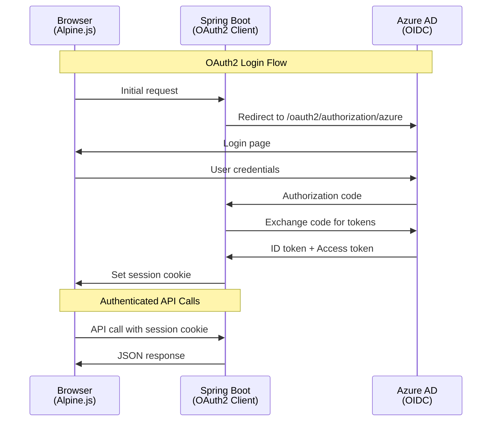

<!-- Original Template from: https://github.com/adr/madr -->

| Metadata        | Value                                   |
|-----------------|-----------------------------------------|
| status          | open                                    |
| date            | ?                                       |
| decision-makers | Project Team R2P                        |
| jira            | https://flow.sbb.ch/browse/BPSGLO-13861 |

# User Interface Technology

## Context

The R2P prototype should include a minimal user interface additionally to the API.
The design of the UI follows the existing prototype under desing/v2
The data is either fetched from the API or included in server side rendered templates.
This facilitates understanding and testing the system and can be used for demos and internal presentations.

## Factors, Requirements and Constraints

* Stability and reliability: should be mature and stable, and not cause significant maintenance effort
* Easy to understand and extend: should be easy to understand for developers with different backgrounds, and allow for easy extensions if needed
* Security: should not introduce significant security risks especially not requiring a lot of dependencies
* Deployment: should be integrable in the same deployment as the API, and not require a separate hosting or deployment solution

## Options Considered

* Option 1: Alpine.js (Lightweight JavaScript Framework)
* Option 2: Angular SPA (Single Page Application)
* Option 3: Thymeleaf (Full Server-Side Rendering)
* Option 4: HTMX (Partial Server-Side Rendering)

### Option 1: Alpine.js (Lightweight JavaScript Framework)

**Description:** Use Alpine.js (15KB) to add reactive data binding to existing HTML/CSS designs. 
Alpine.js is a lightweight JavaScript framework designed for adding interactivity to static HTML without a build step.

**How it works:**
- Reuse existing HTML/CSS designs from design/v2 folder
- Add Alpine.js (~15KB gzipped) as single JavaScript file
- Use HTML attributes (`x-data`, `x-for`, `x-if`, `x-on`) for data binding
- Fetch data from REST API (`/api/v1/trains`) using native `fetch()`
- Files served from `src/main/resources/static/`

**Pros:**
- ✅ Single lightweight dependency (15KB)
- ✅ No build toolchain needed (Maven only)
- ✅ Same deployment as API (single JAR)
- ✅ Easy to understand - HTML-first approach
- ✅ Fast loading and minimal overhead
- ✅ Excellent documentation and community support
- ✅ Can serve Alpine.js locally (no CDN dependency)

**Cons:**
- ❌ Less powerful than full SPA frameworks for complex interactions

---

### Option 2: Angular SPA (Single Page Application)

**Description:** Build a Single Page Application using Angular. Requires separate build toolchain 
(Node.js, npm, Angular CLI) and integration with Maven build.

**Pros:**
- ✅ Rich component ecosystem (Angular Material, etc.)
- ✅ Reactive data binding with RxJS
- ✅ TypeScript provides type safety
- ✅ Highly interactive UI possible
- ✅ Clear separation of frontend/backend
- ✅ Comprehensive framework with routing, forms, HTTP client
- ✅ Strong enterprise adoption

**Cons:**
- ❌ **High complexity** for a prototype/minimal UI
- ❌ Separate build toolchain (Node.js, npm, Angular CLI, webpack)
- ❌ Many dependencies (hundreds of npm packages) - not direct ones but transitive ones
- ❌ **High security risk** (npm vulnerabilities, supply chain attacks) - especially due to transitive dependencies
- ❌ **Significant maintenance overhead** (framework updates, dependency management)
- ❌ Separate deployment or complex build integration (e.g. frontend-maven-plugin) needed
- ❌ Steeper learning curve compared to lightweight options
- ❌ Longer build times

---

### Option 3: Thymeleaf (Full Server-Side Rendering)

**Description:** Use Spring Boot's recommended Thymeleaf template engine for server-side HTML rendering.

**Pros:**
- ✅ Official Spring Boot integration (spring-boot-starter-thymeleaf)
- ✅ Server-side rendering
- ✅ Direct access to Java models (no API calls)
- ✅ Easy to integrate with Spring Security
- ✅ Template reusability with fragments
- ✅ Natural forms and validation support

**Cons:**
- ❌ Less interactive than SPA (page reloads)
- ❌ Requires new controllers for page rendering

**Implementation Effort:** Medium (new dependency, new controllers, template conversion)

---

### Option 4: HTMX (Partial Server-Side Rendering)

**Description:** Use HTMX library (lightweight JS) to make server-rendered HTML interactive without writing JavaScript. 
Works well with Thymeleaf or plain HTML.

**Pros:**
- ✅ Minimal JavaScript required
- ✅ Server-centric architecture (fits Spring Boot well)
- ✅ Progressive enhancement approach
- ✅ Small footprint (1 dependency, ~14KB gzipped)

**Cons:**
- ❌ Requires server endpoints for all interactions

---

## Implementation Notes

It would be possible to implement browser-based OAuth2 flow (PKCE) + Token handling in the frontend for both Alpine.js and Angular, 
but this adds complexity and security risks (exposing tokens in browser).

The current best practice is to use **session-based OAuth2** where Spring Security handles authentication server-side.
The browser (Alpine.js or HTMX) simply makes API calls with the session cookie, and Spring Security ensures the user is authenticated.

See draft RFC https://datatracker.ietf.org/doc/html/draft-ietf-oauth-browser-based-apps



1. Enable Spring Security OAuth2 Login (session-based)
2. User logs in via `/oauth2/authorization/azure`
3. Spring creates session cookie with authenticated user
4. Alpine.js `fetch()` calls include session cookie automatically, if session is expired user gets 401

**Implementation:**

In Spring Boot:
```java
.oauth2Login(oauth2 -> oauth2
    .defaultSuccessUrl("/index.html", true)
)
```

In Alpine.js:
```javascript
async loadTrains() {
  const response = await fetch('/api/v1/trains');

  if (response.status === 401) {
    window.location.href = '/oauth2/authorization/azure';
  }
  
  this.trains = await response.json();
}
```

---

## Recommendation Matrix

| Criterion | Alpine.js | Angular SPA | Thymeleaf | HTMX |
|-----------|-----------|-------------|-----------|------|
| **Stability** | ⭐⭐⭐⭐⭐ | ⭐⭐⭐ | ⭐⭐⭐⭐⭐ | ⭐⭐⭐⭐ |
| **Easy to Understand** | ⭐⭐⭐⭐⭐ | ⭐⭐ | ⭐⭐⭐⭐ | ⭐⭐⭐ |
| **Security** | ⭐⭐⭐⭐⭐ | ⭐⭐ | ⭐⭐⭐⭐⭐ | ⭐⭐⭐⭐ |
| **Deployment** | ⭐⭐⭐⭐⭐ | ⭐⭐ | ⭐⭐⭐⭐⭐ | ⭐⭐⭐⭐⭐ |
| **Maintenance** | ⭐⭐⭐⭐⭐ | ⭐⭐ | ⭐⭐⭐⭐ | ⭐⭐⭐⭐ |

---

---

## Recommended Approach

**Top Recommendation: Option 1 (Alpine.js)**

Rationale:
1. ✅ **Reuses existing HTML/CSS designs** from design/v2
2. ✅ **Dynamic API integration** with minimal framework overhead
3. ✅ **Single lightweight dependency** (15KB - can be local file)
4. ✅ **No build toolchain** needed (serve JS file from /static/js/)
5. ✅ **Easy to understand** for developers familiar with HTML
6. ✅ **Same deployment** as API (single JAR)
7. ✅ **Minimal security risk** (1 file vs. hundreds of npm packages)
8. ✅ **Mature and stable** with excellent documentation

**Second Choice: Option 3 (Thymeleaf)**

If server-side rendering is strongly preferred or you want to avoid any JavaScript framework, Thymeleaf is a solid choice with tight Spring Boot integration. However, this requires:
- New controllers for page rendering
- Template conversion (cannot reuse existing HTML designs without modification)
- Less interactive UI (page reloads for updates)

**Not Recommended:**
- **Option 2 (Angular SPA):** Massive overkill for prototype, high complexity and maintenance overhead
- **Option 4 (HTMX):** Good technology but requires server-side endpoints for all interactions, more effort than Alpine.js for this use case

